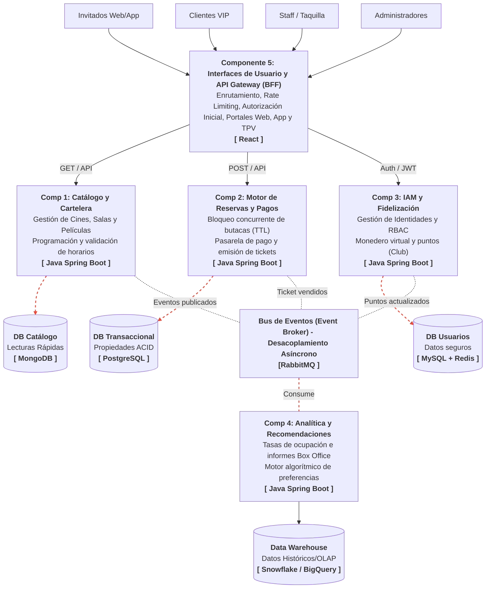

**CinAsee** es una plataforma de cine distribuida: catálogo y cartelera,
reservas y pagos, identidad y fidelización, analítica y recomendaciones, todo
detrás de un API Gateway. Cada dominio es un microservicio independiente con su
propia base de datos.

## Estructura proyecto


---

## Cómo funciona

### Componentes

| Componente | Responsabilidad | Tecnología | README |
|---|---|---|---|
| **C1 · Catálogo y Cartelera** | Cines, películas, salas y programación de sesiones | Spring Boot + MongoDB | [Ver](componente1-cartelera/README.md) |
| **C2 · Reservas y Pagos** | Bloqueo de butacas, precios, pago, tickets e informes | Spring Boot + PostgreSQL | [Ver](componente2-reservas/README.md) |
| **C3 · IAM y Fidelización** | Login, registro, invitados, roles, puntos e historial | Spring Boot + MySQL + Redis | [Ver](componente3-usuarios/README.md) |
| **C4 · Analítica** | Ocupación, Box Office y recomendaciones | Spring Boot + PostgreSQL | [Ver](componente4-analitica/README.md) |
| **C5 · Gateway** | Punto de entrada, rutas, CORS y validación de JWT | Spring Boot | [Ver](componente5-gateway/README.md) |
| **Frontend** | Interfaz web | React + Vite | [Ver](frontend-ui/README.md) |

### Bases de datos (una por servicio)

| Servicio | Motor | Base | Puerto host |
|---|---|---|---|
| C1 | MongoDB | `cine_catalog_db` | `27017` |
| C2 | PostgreSQL | `cine_reservas_db` | `5433` |
| C3 | MySQL | `cinasee_users_db` | `3306` |
| C3 | Redis | caché / rate limit | `6379` |
| C4 | PostgreSQL | `cine_analytics_dw` | `5434` |
| Todos | RabbitMQ | bus de eventos | `5672` (UI `15672`) |

Ningún servicio lee la base de datos de otro: el cruce de datos se hace por HTTP
o por eventos. Es el principio *database per service*.

### Flujo de una compra

```
1. El cliente entra en el frontend (React, :3000) y hace login en C3.
   * Recibe un JWT firmado con RS256.

2. Consulta la cartelera en C1 a través del Gateway.
   * GET /api/v1/movies?inShowcase=true
   * GET /api/v1/sessions?movieId=...

3. Elige butacas y crea la reserva en C2.
   * C2 valida sesión y sala contra C1 y el perfil contra C3.
   * Bloquea las butacas 10 minutos (UNIQUE en PostgreSQL).

4. Paga.
   * Modo simulado o Redsys.
   * C2 confirma, emite un ticket por butaca y guarda el evento en su outbox.

5. El outbox publica PaymentCompleted en RabbitMQ.
   * C3 suma puntos y guarda el historial.
   * C4 registra el hecho de venta en analytics_events.

6. C4 calcula ocupación y taquilla.
   * Consulta las ventas agregadas de C2 y el aforo de C1.
   * Devuelve /api/metrics/occupancy y /api/reports/box-office.

7. El personal de sala valida la entrada.
   * POST /v1/reservations/tickets/{code}/check-in (solo staff/admin).
```

### Comunicación síncrona y asíncrona

| Tipo | Cuándo | Ejemplo |
|---|---|---|
| **Síncrona (OpenFeign)** | Se necesita una respuesta para continuar | C2 valida la sesión en C1 antes de reservar |
| **Asíncrona (RabbitMQ)** | El hecho ya ocurrió y otros reaccionan | `PaymentCompleted` -> puntos (C3) y analítica (C4) |

La comunicación asíncrona usa el patrón **outbox** en C2: el evento se guarda en
la misma transacción del pago y un relay lo publica después. Así no se pierde
una venta si RabbitMQ falla en ese instante.

---

## Puertos

| Servicio | URL |
|---|---|
| Frontend | `http://localhost:3000` |
| Gateway | `http://localhost:8080` |
| C1 Cartelera | `http://localhost:8081/api/v1` |
| C2 Reservas | `http://localhost:8082/v1` |
| C3 IAM | `http://localhost:8083/v1/iam` |
| C4 Analítica | `http://localhost:8084/api` |
| RabbitMQ (UI) | `http://localhost:15672` |

---

## Puesta en marcha

### Arranque rápido (recomendado)

Un único comando comprueba Docker, construye las imágenes, levanta los
contenedores, espera a que todos respondan por HTTP y muestra un resumen con
URLs y credenciales.

**Windows** — doble clic en `ARRANCAR.bat` o, desde PowerShell:

```powershell
.\scripts\iniciar.ps1
```

**macOS / Linux**:

```bash
./scripts/iniciar.sh
```

Si el clon no conserva el permiso de ejecución, usa `bash scripts/iniciar.sh`
o ejecuta una vez `chmod +x scripts/*.sh`.

Opciones disponibles (mismos nombres en PowerShell y en bash):

| PowerShell | bash | Efecto |
|---|---|---|
| `-BorrarDatos` | `--borrar-datos` | `down -v` y regenera los seeds (pide confirmación) |
| `-Reiniciar` | `--reiniciar` | `down` antes de levantar, conservando datos |
| `-SinBuild` | `--sin-build` | Reutiliza las imágenes ya construidas |
| `-NoAbrir` | `--no-abrir` | No abre el navegador al terminar |
| `-TimeoutSegundos N` | `--timeout=N` | Espera máxima por servicio (240 s por defecto) |

Para comprobar el estado sin arrancar nada:

```powershell
.\scripts\estado.ps1     # macOS/Linux: ./scripts/estado.sh
```

Para parar:

```powershell
.\scripts\detener.ps1              # conserva los datos
.\scripts\detener.ps1 -BorrarDatos # borra los volúmenes
```

El script abre `http://localhost:3000` (no `127.0.0.1`) porque el CORS del
Gateway solo permite ese origen.

> Las sesiones que siembra C1 caducan a los ~3 días. Si
> `GET /api/v1/movies?inShowcase=true` devuelve `[]`, arranca con
> `-BorrarDatos` / `--borrar-datos` para regenerar el catálogo.

### Todo el sistema (manual)

```bash
docker compose up -d --build
docker compose ps
```

La primera vez tarda porque cada servicio compila dentro de su imagen.

### Servicios sueltos

```bash
docker compose up -d mysql-usuarios redis-usuarios rabbitmq componente3-usuarios
docker compose up -d mongodb-cartelera componente1-cartelera
docker compose up -d postgres-reservas componente2-reservas
docker compose up -d postgres-analitica componente4-analitica
docker compose up -d componente5-gateway
```

### Frontend

```bash
cd frontend-ui
npm install
npm run dev
```

### Parar

```bash
docker compose down          # conserva los datos
docker compose down -v       # borra los volúmenes
```

### Logs

```bash
docker compose logs -f componente2-reservas
```

---

## Credenciales de prueba

| Rol | Email | Contraseña |
|---|---|---|
| Administrador | `admin@cinasee.com` | `Admin123!` |
| Staff / taquilla | `staff@cinasee.com` | `Staff123!` |
| Cliente | `usuario@cinasee.com` | `Usuario123!` |

```bash
curl -X POST http://localhost:8080/v1/iam/auth/login \
  -H "Content-Type: application/json" \
  -d '{"email":"admin@cinasee.com","password":"Admin123!"}'
```

---

## Decisiones transversales

### 1. Database per service

Cada microservicio es dueño de su esquema. No hay accesos cruzados a bases de
datos: si C2 necesita el aforo, lo pide a C1; si C4 necesita ventas, las pide a
C2.

### 2. JWT asimétrico (RS256) con JWKS

Solo el Componente 3 posee la clave privada y puede firmar tokens. Los demás
descargan la clave pública de `/.well-known/jwks.json` y validan en local. Con un
JWT simétrico (HS256) todos los servicios compartirían el secreto y cualquiera
comprometido podría fabricar tokens de administrador.

Detalle completo en [C3 › Seguridad](componente3-usuarios/README.md#5-seguridad-por-qué-rs256-y-no-un-jwt-simétrico).

### 3. Síncrono para consultar, asíncrono para notificar

- **Feign** cuando el resultado condiciona la operación (validar sesión, cobrar).
- **RabbitMQ** cuando el hecho ya está confirmado y varios consumidores
  reaccionan sin bloquear al emisor.

### 4. Outbox en el pago

El evento se persiste junto al cambio de estado de la reserva. Un relay lo
publica con *publisher confirms*. Si el broker no confirma, se reintenta.

### 5. Gateway como único punto de entrada

El frontend solo conoce `http://localhost:8080`. El Gateway aplica CORS y
rechaza peticiones sin token en rutas protegidas; cada microservicio vuelve a
validar el JWT y sus roles.

### 6. Zona horaria explícita

Las sesiones de C1 son `LocalDateTime` sin zona. C2 las interpreta con
`CATALOG_TIME_ZONE` y C4 con `ANALYTICS_TIME_ZONE`; ambos valen
`Europe/Madrid` en el compose para que día y franja horaria coincidan.

### 7. Seed idempotente

C3 crea sus tres usuarios al arrancar y C1 crea sus cines, películas, salas y
sesiones con el mismo patrón (`CommandLineRunner` + `existsById`). Ambos seeds
son idempotentes: si el documento ya existe, no lo modifican. Se desactivan con
`APP_SEED_ENABLED=false`. Ver
[seed de cartelera](componente1-cartelera/docs/seed-cartelera.md).

### 8. Cines en C1 y filtro por cine en C4

El Componente 1 modela cines: `Cinema` y `Room.cinemaId`, con endpoints
públicos `GET /cinemas`, `GET /cinemas/{id}` y `GET /cinemas/{id}/rooms`, además
del filtro `GET /rooms?cinemaId=`.

Estado real del `cinemaId` en cada componente:

- **C4 (analítica) sí filtra por cine.** Pide a C1 las salas del cine
  (`GET /rooms?cinemaId=`) y descarta las filas de venta de C2 cuyo `roomId` no
  está en ese conjunto; el aforo se calcula con esas mismas salas. Si C1 no
  responde, usa un aforo estimado y no filtra, con `log.warn`.
- **C3 (usuarios)** guarda `cinemaId` como `String`, pero **no lo valida**
  contra el catálogo de C1. Ese valor solo se usa para limitar qué solicitudes
  de rol puede revisar un `STAFF_TAQUILLA` con `cinemaManager = true`. El
  `docker-compose.yml` fija `APP_SEED_STAFF_CINEMA_ID` al UUID del cine de
  Madrid de C1 (`550e8400-e29b-41d4-a716-446655440001`) para que la taquilla
  demo y las solicitudes de rol apunten al mismo cine.
- **C2 (reservas)** trabaja por `sessionId`/`roomId` y su `CatalogRoom` ignora
  `cinemaId` (`@JsonIgnoreProperties(ignoreUnknown = true)`), así que no rompe
  con el C1 nuevo pero tampoco filtra por cine.

Pendiente si se quiere el filtro de punta a punta: que C2 acepte y propague
`cinemaId`, y que C3 valide el cine del staff contra `GET /cinemas/{id}`.

---

## Estructura del repositorio

```
CinAsee/
├── componente1-cartelera/     Catálogo y cartelera (MongoDB)
├── componente2-reservas/      Reservas y pagos (PostgreSQL)
├── componente3-usuarios/      IAM y fidelización (MySQL + Redis)
├── componente4-analitica/     Analítica y recomendaciones (PostgreSQL)
├── componente5-gateway/       API Gateway
├── frontend-ui/               React + Vite
├── OpenAPI specs/             Contratos de los componentes 1–4
├── docker-compose.yml         Infraestructura y microservicios
├── scripts/                   Arranque, parada y estado (PowerShell y bash)
├── ARRANCAR.bat               Doble clic para arrancar en Windows
├── DETENER.bat                Doble clic para parar en Windows
├── LICENSE
└── README.MD
```

---

## Documentación

| Documento | Contenido |
|---|---|
| [C1](componente1-cartelera/README.md) | Catálogo, sesiones y seguridad |
| [Seed de cartelera](componente1-cartelera/docs/seed-cartelera.md) | Datos y decisiones para llenar MongoDB |
| [C2](componente2-reservas/README.md) | Reservas, precios, pagos, outbox e informes |
| [C3](componente3-usuarios/README.md) | IAM, RS256/JWKS, roles, seed y rate limit |
| [C4](componente4-analitica/README.md) | Ocupación, Box Office y recomendaciones |
| [C5](componente5-gateway/README.md) | Rutas, CORS y validación de tokens |
| [Frontend](frontend-ui/README.md) | Comandos y comunicación con el Gateway |

## Licencia

Este proyecto está bajo la licencia **PolyForm Noncommercial License 1.0.0**.
Se permite su uso, estudio y modificación únicamente con fines no comerciales o académicos.
Consulta el archivo [LICENSE](./LICENSE) para más detalles.