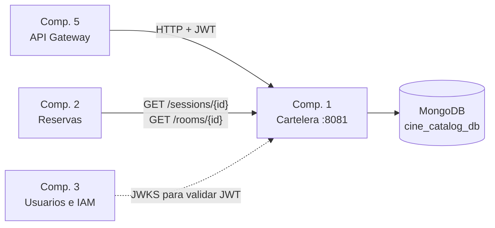
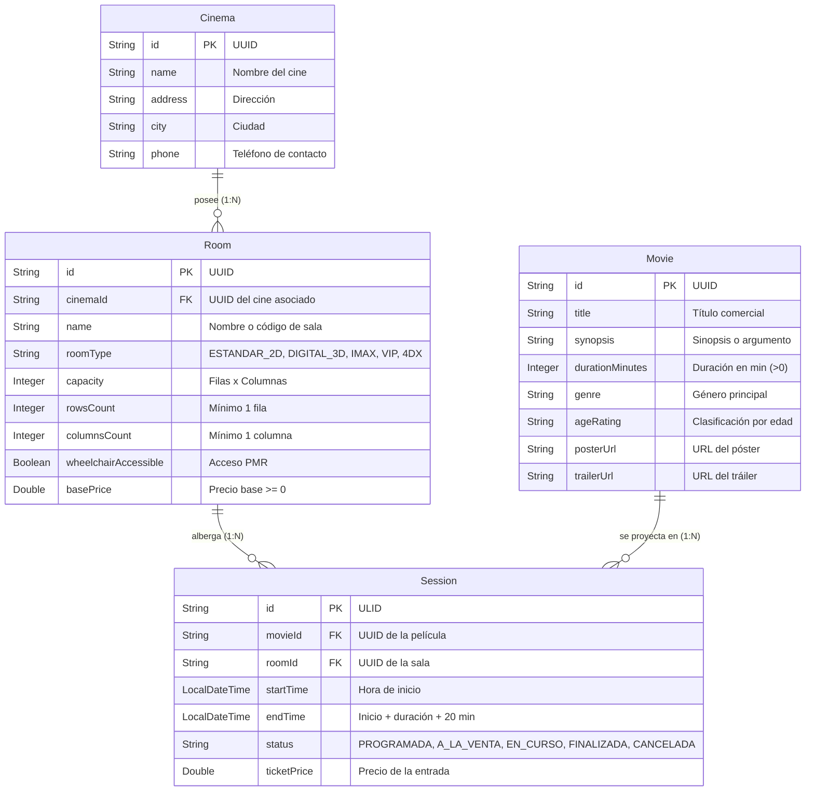

# Componente 1 · Catálogo, Cines, Salas y Cartelera

Microservicio Spring Boot responsable del catálogo de películas, la gestión de cines,
las salas de proyección y la programación de sesiones. Comprueba que las películas,
cines y salas existan y evita solapamientos horarios en una misma sala.

| | |
|---|---|
| Puerto | `8081` |
| URL base | `http://localhost:8081/api/v1` |
| Base de datos | MongoDB `cine_catalog_db` |
| Contrato | [`openapi/componente_1.yaml`](../openapi/componente_1.yaml) |
| Paquete | `com.cinasee.componente1_cartelera` |

Documentos relacionados:

- [ejecucion-y-pruebas.md](ejecucion-y-pruebas.md): arranque, comprobación de MongoDB y pruebas.
- [seed-cartelera.md](seed-cartelera.md): carga automática/manual y estado del catálogo de demostración.

## 1. Lugar en la arquitectura



El Componente 1 es propietario de las películas, cines, salas y sesiones. Los demás
componentes consultan sus datos por la API; no acceden directamente a MongoDB.

## 2. Relación de objetos y modelo de dominio

El microservicio gestiona cuatro entidades principales (`Cinema`, `Room`, `Movie` y `Session`):



### Reglas de asociación y negocio entre objetos

1. **Cine y Salas (1 a N):**
   - Cada sala (`Room`) pertenece obligatoriamente a un cine (`Cinema`) a través de `cinemaId`.
   - Al registrar una sala (`POST /rooms`), se valida la existencia del cine correspondiente.
   - Es posible consultar todas las salas de un cine concreto (`GET /cinemas/{cinemaId}/rooms` o `GET /rooms?cinemaId={id}`).

2. **Proyección multicine de películas:**
   - La entidad `Movie` es global e independiente de los cines. No contiene el atributo `distributor`.
   - **Varios cines pueden proyectar la misma película:** la asignación se realiza en la entidad `Session`, vinculando el `movieId` con una `roomId` perteneciente al cine deseado.
   - Cada cine gestiona de forma autónoma su disponibilidad de salas, horarios y precios para esa película.

3. **Sala y Sesión (Control de Solapamiento):**
   - Una sala puede albergar múltiples sesiones a lo largo del tiempo, pero **nunca solapadas**.
   - La duración total bloqueada se calcula como: `duración de la película + 20 minutos de preparación y limpieza`.
   - Cualquier intento de programar o mover una sesión a un horario solapado en la misma sala devuelve `409 Conflict`.

## 3. Tecnologías

| Tecnología | Uso |
|---|---|
| Java 21 y Spring Boot | Aplicación y API REST |
| Spring Web MVC | Controladores HTTP |
| Spring Data MongoDB | Persistencia de cines, películas, salas y sesiones |
| MongoDB | Base de datos documental del catálogo |
| Bean Validation | Validación de peticiones (`@NotNull`, `@NotBlank`, `@Min`) |
| Spring Security y OAuth2 Resource Server | Validación de JWT emitidos por el Componente 3 |
| Lombok | Código repetitivo de modelos y servicios |
| JUnit y Mockito | Pruebas unitarias, de integración y aceptación |

## 4. Organización del código

```text
componente1-cartelera/
├── src/main/java/com/cinasee/componente1_cartelera/
│   ├── config/       Seguridad (endpoints públicos y protegidos por JWT)
│   ├── controllers/  Controladores REST (CinemaController, MovieController, RoomController, SessionController)
│   ├── models/       Modelos de datos MongoDB y DTOs de petición
│   ├── repositories/ Repositorios Spring Data MongoDB (Cinema, Movie, Room, Session)
│   └── services/     Lógica de negocio y validaciones de solapamiento
├── src/main/resources/application.yaml
├── src/test/         Pruebas unitarias, integración y aceptación
├── openapi/          Contrato OpenAPI (componente_1.yaml v2.0.0)
└── docs/             Documentación técnica
```

## 5. API y acceso

La ruta base es `/api/v1`. Los detalles de parámetros, modelos y respuestas están
en el [contrato OpenAPI](../openapi/componente_1.yaml).

| Método | Ruta | Acceso | Función |
|---|---|---|---|
| `GET` | `/cinemas` | Público | Listar cines, con filtro opcional por ciudad (`?city=`) |
| `POST` | `/cinemas` | JWT | Registrar un nuevo cine |
| `GET` | `/cinemas/{cinemaId}` | Público | Consultar el detalle de un cine |
| `PUT` | `/cinemas/{cinemaId}` | JWT | Actualizar datos de un cine |
| `DELETE` | `/cinemas/{cinemaId}` | JWT | Eliminar un cine |
| `GET` | `/cinemas/{cinemaId}/rooms` | Público | Listar las salas de un cine específico |
| `GET` | `/movies` | Público | Listar y filtrar películas por género o cartelera activa |
| `POST` | `/movies` | JWT | Crear una película (sin distribuidor) |
| `GET` | `/movies/{movieId}` | Público | Consultar una película |
| `PUT` | `/movies/{movieId}` | JWT | Actualizar una película |
| `DELETE` | `/movies/{movieId}` | JWT | Eliminar una película |
| `GET` | `/rooms` | JWT | Listar salas (filtro opcional por `?cinemaId=`) |
| `POST` | `/rooms` | JWT | Crear una sala vinculada a un cine (`cinemaId`); aforo = filas × columnas |
| `GET` | `/rooms/{roomId}` | JWT | Consultar una sala |
| `GET` | `/sessions` | Público | Consultar cartelera, opcionalmente por fecha o película |
| `POST` | `/sessions` | JWT | Programar una sesión validando solapamientos |
| `GET` | `/sessions/{sessionId}` | JWT | Consultar una sesión |
| `PATCH` | `/sessions/{sessionId}` | JWT | Cambiar estado, sala u hora de una sesión |

La programación calcula el fin de la sesión sumando la duración de la película y
20 minutos de preparación. Si el intervalo se solapa con otra sesión no cancelada
de la misma sala, la API responde `409 Conflict`. Las peticiones inválidas
responden `400` y los recursos inexistentes, `404`.

## 6. Persistencia

Las clases anotadas con `@Document` usan las colecciones `cinemas`, `movies`, `rooms` y
`sessions`. MongoDB crea la base y cada colección al persistir los primeros
documentos; por tanto, que no aparezcan colecciones en una instalación nueva no
significa necesariamente que exista un error.

Los IDs de cine, película y sala son UUID de texto; el ID de sesión es un ULID.
C1 ejecuta `CatalogSeeder` automáticamente al arrancar, salvo que
`APP_SEED_ENABLED=false`. La carga es idempotente y no modifica documentos
existentes con el mismo ID. También puede cargarse manualmente el
[`scripts/seed-catalog.mongodb.js`](../scripts/seed-catalog.mongodb.js).

Los pósteres se sirven por el servicio `media-server` a través del Gateway:
`http://localhost:8080/media/posters/<nombre>.jpg`. El script manual y el
seeder automático usan las mismas URL públicas.

El catálogo reproducible contiene 7 cines, 8 películas, 12 salas y 278 sesiones de
demostración para los 14 días siguientes al primer arranque. Las sesiones se reparten entre Madrid, Barcelona, Cáceres,
Navatrasierra, Madroñera, Málaga y Cuenca. El script es idempotente y conserva
los documentos existentes con el mismo ID. Consulta
[seed-cartelera.md](seed-cartelera.md) para ejecutar y comprobar la carga.

La URI predeterminada para ejecutar la aplicación fuera de Docker es
`mongodb://localhost:27017/cine_catalog_db`. En Docker Compose se configura
`mongodb://mongodb-cartelera:27017/cine_catalog_db`, mediante la variable
`SPRING_MONGODB_URI`. Spring Boot usa la propiedad `spring.mongodb.uri`.
