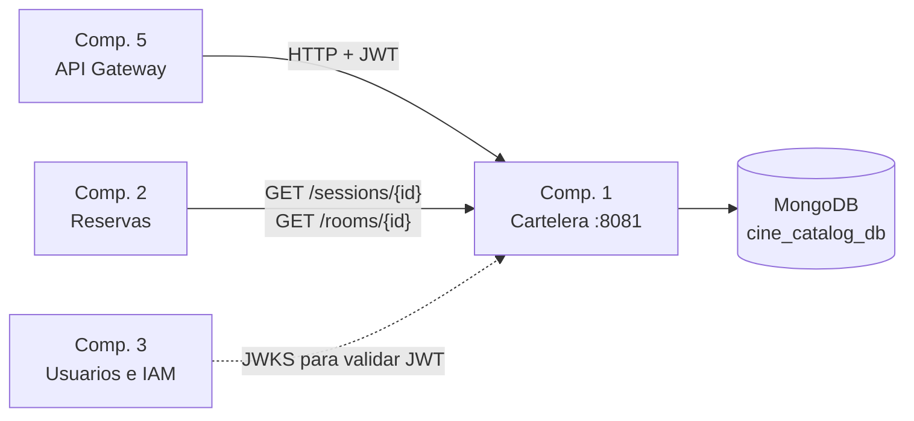

# Componente 1 · Catálogo, Salas y Cartelera

Microservicio Spring Boot responsable del catálogo de películas, las salas de
proyección y la programación de sesiones. Comprueba que las películas y salas
existan y evita solapamientos horarios en una misma sala.

| | |
|---|---|
| Puerto | `8081` |
| URL base | `http://localhost:8081/api/v1` |
| Base de datos | MongoDB `cine_catalog_db` |
| Contrato | [`openapi/componente_1.yaml`](../openapi/componente_1.yaml) |
| Paquete | `com.cinasee.componente1_cartelera` |

Documentos relacionados:

- [ejecucion-y-pruebas.md](ejecucion-y-pruebas.md): arranque, comprobación de MongoDB y pruebas.

## 1. Lugar en la arquitectura



El Componente 1 es propietario de las películas, salas y sesiones. Los demás
componentes consultan sus datos por la API; no acceden directamente a MongoDB.

## 2. Tecnologías

| Tecnología | Uso |
|---|---|
| Java 21 y Spring Boot | Aplicación y API REST |
| Spring Web MVC | Controladores HTTP |
| Spring Data MongoDB | Persistencia de películas, salas y sesiones |
| MongoDB | Base de datos documental del catálogo |
| Bean Validation | Validación de peticiones (`@NotNull`, `@NotBlank`, `@Min`) |
| Spring Security y OAuth2 Resource Server | Validación de JWT emitidos por el Componente 3 |
| Lombok | Código repetitivo de modelos y servicios |
| JUnit y Mockito | Pruebas unitarias, de integración y aceptación |

## 3. Organización del código

```text
componente1-cartelera/
├── src/main/java/com/cinasee/componente1_cartelera/
│   ├── config/       Seguridad
│   ├── controllers/  Endpoints de películas, salas y sesiones
│   ├── models/       Documentos MongoDB y peticiones
│   ├── repositories/ Repositorios Spring Data MongoDB
│   └── services/     Reglas de negocio y validaciones
├── src/main/resources/application.yaml
├── src/test/         Pruebas unitarias, integración y aceptación
├── openapi/          Contrato OpenAPI
└── docs/             Esta documentación
```

## 4. API y acceso

La ruta base es `/api/v1`. Los detalles de parámetros, modelos y respuestas están
en el [contrato OpenAPI](../openapi/componente_1.yaml).

| Método | Ruta | Acceso | Función |
|---|---|---|---|
| `GET` | `/movies` | Público | Listar y filtrar películas por género o cartelera |
| `POST` | `/movies` | JWT | Crear una película |
| `GET` | `/movies/{movieId}` | Público | Consultar una película |
| `PUT` | `/movies/{movieId}` | JWT | Actualizar una película |
| `DELETE` | `/movies/{movieId}` | JWT | Eliminar una película |
| `GET` | `/rooms` | JWT | Listar salas |
| `POST` | `/rooms` | JWT | Crear una sala; el aforo se calcula como filas × columnas |
| `GET` | `/rooms/{roomId}` | JWT | Consultar una sala |
| `GET` | `/sessions` | Público | Consultar cartelera, opcionalmente por fecha o película |
| `POST` | `/sessions` | JWT | Programar una sesión |
| `GET` | `/sessions/{sessionId}` | JWT | Consultar una sesión |
| `PATCH` | `/sessions/{sessionId}` | JWT | Cambiar estado, sala u hora de una sesión |

La programación calcula el fin de la sesión sumando la duración de la película y
20 minutos de preparación. Si el intervalo se solapa con otra sesión no cancelada
de la misma sala, la API responde `409 Conflict`. Las peticiones inválidas
responden `400` y los recursos inexistentes, `404`.

## 5. Persistencia

Las clases anotadas con `@Document` usan las colecciones `movies`, `rooms` y
`sessions`. MongoDB crea la base y cada colección al persistir los primeros
documentos; por tanto, que no aparezcan colecciones en una instalación nueva no
significa necesariamente que exista un error.

La URI predeterminada para ejecutar la aplicación fuera de Docker es
`mongodb://localhost:27017/cine_catalog_db`. En Docker Compose se configura
`mongodb://mongodb-cartelera:27017/cine_catalog_db`, mediante la variable
`SPRING_MONGODB_URI`. Spring Boot 4 usa la propiedad `spring.mongodb.uri`.
