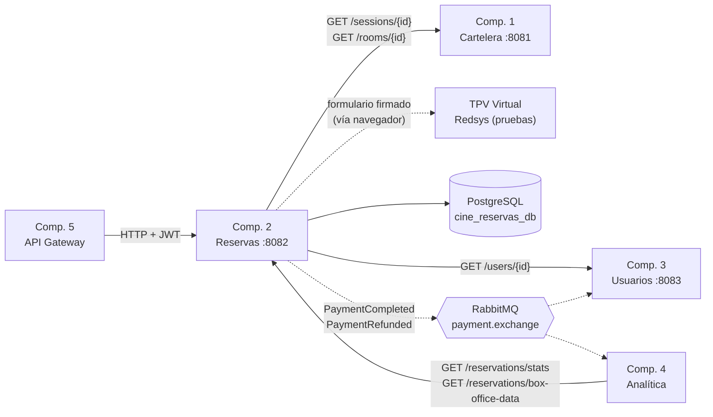
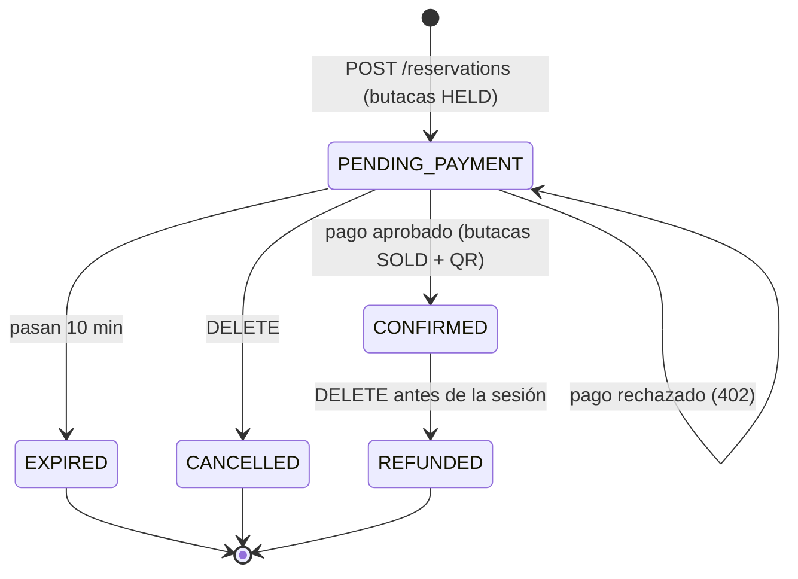
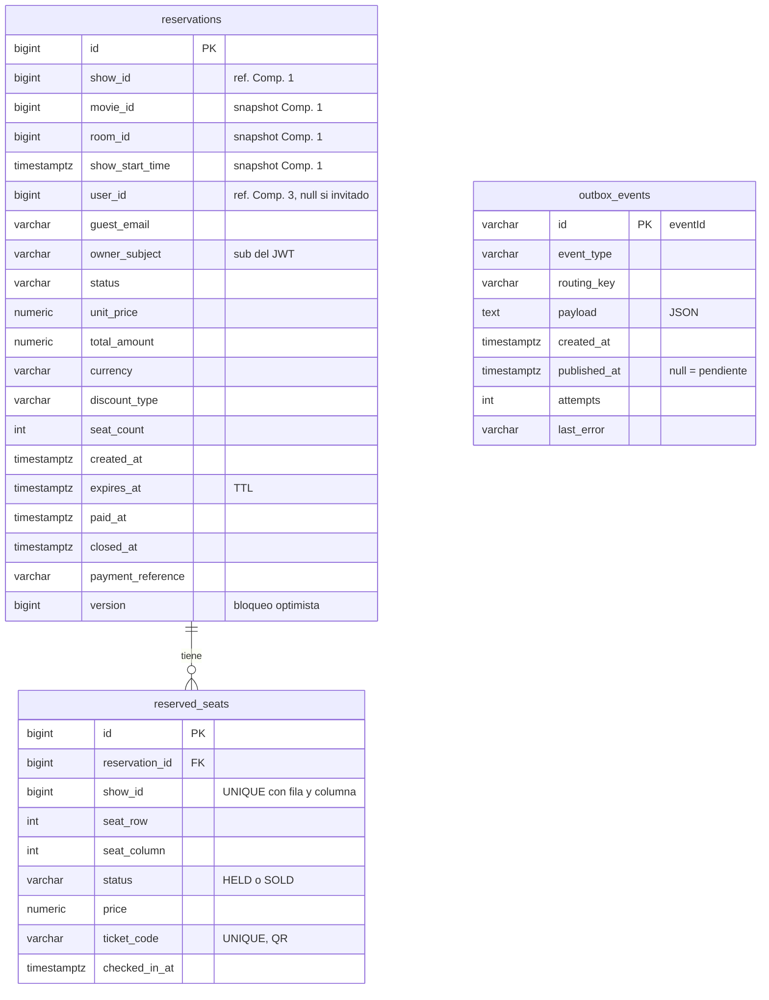

# Componente 2 · Reservas, Asientos y Pagos

Microservicio Spring Boot que gestiona la compra de entradas de CinAsee: bloquea
butacas durante 10 minutos, cobra a través de la pasarela, emite las entradas y
avisa al resto del sistema con un evento asíncrono.

| | |
|---|---|
| Puerto | `8082` |
| URL base | `http://localhost:8082/v1/reservations` |
| Base de datos | PostgreSQL `cine_reservas_db` (propia, nadie más accede) |
| Contrato | [`openapi/componente_2.yaml`](../openapi/componente_2.yaml) (copiado en `OpenAPI specs/`) |
| Paquete | `com.cinasee.componente2_reservas` |

Documentos relacionados:

- [ejecucion-aislada.md](ejecucion-aislada.md): cómo arrancar y probar este microservicio sin los demás.
- [evento-payment-completed.md](evento-payment-completed.md): el contrato del evento que publica.

---

## 1. Lugar en la arquitectura



Línea continua: comunicación síncrona (REST). Discontinua: asíncrona (eventos).

**Regla que se cumple en todo el código:** el Componente 2 nunca lee ni escribe
en las bases de datos de otros componentes. Lo que necesita de Cartelera o de
Usuarios lo pide por su API REST, y lo que los demás necesitan de Reservas lo
obtienen por la API de Reservas o por los eventos de RabbitMQ.

---

## 2. Tecnologías y para qué se usa cada una

Son las dependencias que ya se eligieron para el Componente 2 en la memoria
(Spring Web, Spring Data JPA, PostgreSQL Driver, Spring for RabbitMQ, OpenFeign,
Lombok, Validation), más las que se añadieron y por qué:

| Tecnología | Uso en este componente | Dónde |
|---|---|---|
| **Spring Web MVC** | API REST: controladores, códigos HTTP, manejador global de errores | `controllers/`, `exceptions/GlobalExceptionHandler` |
| **Spring Data JPA + Hibernate** | Entidades, repositorios, transacciones ACID, bloqueos `FOR UPDATE` y `@Version` | `models/`, `repositories/`, `@Transactional` en `services/` |
| **PostgreSQL** | Base de datos transaccional propia. La restricción `UNIQUE` impide la doble venta | `application.yaml` |
| **OpenFeign** | Clientes HTTP declarativos hacia Cartelera, Usuarios y la pasarela | `clients/` |
| **Spring for RabbitMQ (AMQP)** | Publicación de `PaymentCompleted` / `PaymentRefunded` con *publisher confirms* | `events/RabbitEventPublisher`, `config/RabbitMQConfig` |
| **Bean Validation** | `@Valid`, `@NotNull`, `@Min`, `@Size`, `@Email` → 400 automático | `dto/` |
| **Lombok** | Getters/setters/builders de las entidades, `@RequiredArgsConstructor`, `@Slf4j` | todo el código |
| **Spring Security + OAuth2 Resource Server** *(añadida)* | Valida los JWT RS256 del Componente 3 con su JWKS y aplica roles | `config/SecurityConfig` |
| **H2** *(añadida, solo test)* | BD en memoria en modo PostgreSQL para probar transacciones y concurrencia sin Docker | `src/test/resources/application-test.yaml` |
| **Spring Security Test** *(añadida, solo test)* | `jwt()` para simular tokens en MockMvc | `ReservationControllerTest` |

Por qué se añadió seguridad: la especificación OpenAPI declara `bearerAuth` en toda
la API y los Componentes 1 y 3 ya validan los tokens del mismo modo. Sin ella,
cualquiera podría pagar o cancelar reservas ajenas.

Versiones: Java 21, Spring Boot 4.1.2, Spring Cloud 2025.1.4 (OpenFeign 5.0.4), Jackson 3.

---

## 3. Organización del código

```
componente2-reservas/
├── src/main/java/com/cinasee/componente2_reservas/
│   ├── Componente2ReservasApplication.java   @EnableFeignClients, @ConfigurationPropertiesScan
│   ├── clients/        Feign: CarteleraClient, UsuariosClient + DTOs remotos y de la pasarela
│   │                   ForwardJwtFeignConfig (reenvía el JWT solo a Comp. 1 y 3)
│   ├── config/         Seguridad, RabbitMQ, planificador, reloj, propiedades tipadas
│   ├── controllers/    ReservationController, ReportController, TicketController
│   ├── dto/            Peticiones y respuestas de la API (records con validación)
│   ├── events/         Eventos, Outbox (OutboxService, OutboxRelay), publicador RabbitMQ
│   ├── exceptions/     Excepciones de negocio → códigos HTTP + GlobalExceptionHandler
│   ├── models/         Entidades JPA: Reservation, ReservedSeat, OutboxEvent y enums
│   ├── repositories/   Spring Data JPA (con bloqueos y consultas agregadas)
│   ├── security/       CallerIdentity (sub + rol extraídos del JWT)
│   └── services/       Lógica de negocio (ver sección 4)
│       └── payment/    Puerto PaymentGateway (Simulated, Redsys) + RedsysSignature (firma HMAC)
├── src/main/resources/ application.yaml, application-isolated.yaml
├── src/test/           Tests unitarios, de controlador y de integración
├── openapi/            componente_2.yaml
├── docs/               Esta documentación
├── wiremock/mappings/  Simulación de Cartelera, Usuarios y Redsýs
├── scripts/            generate-dev-token.ps1
├── http/               reservas.http (colección de peticiones de prueba)
├── Dockerfile
└── docker-compose.yml  Entorno aislado (PostgreSQL + RabbitMQ + WireMock)
                        (la app completa va en el docker-compose.yml de la raíz)
```

Los controladores son finos: sacan la identidad del token, llaman al servicio y
devuelven la respuesta. Toda la lógica está en `services/`.

---

## 4. Lógica de negocio

### 4.1 Endpoints

| Método y ruta | Quién | Qué hace |
|---|---|---|
| `POST /reservations` | cualquier token | Bloquea butacas 10 min → `201` |
| `GET /reservations` | cualquier token | Mis reservas (staff: `?userId=`) |
| `GET /reservations/{id}` | propietario o staff | Detalle |
| `POST /reservations/{id}/payment` | propietario o staff | Pago directo con la pasarela **simulada** → `200` |
| `POST /reservations/{id}/payment/redsys` | propietario o staff | **Redsys:** devuelve el formulario firmado para ir a la web de pago |
| `POST /reservations/{id}/payment/redsys/confirm` | propietario o staff | **Redsys:** valida la respuesta firmada y emite las entradas |
| `GET /reservations/payments/redsys/return` | público (lo protege la firma) | **Redsys:** página de vuelta del navegador (para probar sin frontend) |
| `DELETE /reservations/{id}` | propietario o staff | Cancela (pendiente) o devuelve (pagada) |
| `GET /reservations/shows/{showId}/seats` | público | Butacas ocupadas para el mapa |
| `POST /reservations/tickets/{code}/check-in` | STAFF_TAQUILLA, ADMIN | Valida la entrada en la puerta |
| `GET /reservations/stats` | STAFF_TAQUILLA, ADMIN | Entradas vendidas por sesión (para el Comp. 4) |
| `GET /reservations/box-office-data` | STAFF_TAQUILLA, ADMIN | Taquilla por película (para el Comp. 4) |

Los dos últimos ya los referenciaba la especificación del Componente 4
(`Analytics -> Reservas -> GET /reservations/stats` y `.../box-office-data`),
pero no existían en la del Componente 2. Se han añadido.

### 4.2 Ciclo de vida de una reserva



Al pasar a EXPIRED, CANCELLED o REFUNDED se borran las butacas de la reserva y
vuelven a estar libres. La reserva se conserva como histórico (con `seatCount`).
Se han añadido los estados `EXPIRED` y `REFUNDED` a la especificación.

### 4.3 Crear una reserva (`ReservationService` + `SeatLockService`)

1. **Validaciones locales**: entre 1 y 10 butacas, filas y columnas ≥ 1, sin repetir.
2. **Identidad** (sale del JWT, no del cuerpo de la petición):
   - `VISITANTE` (invitado): no puede indicar `userId` y `guestEmail` es obligatorio.
     La memoria pide permitir la compra sin registro, vinculada solo a un correo.
   - `CLIENTE_REGISTRADO`: solo para sí mismo. Si no manda `userId`, se usa el de su
     token, para que no pierda los puntos de fidelización por olvidarlo.
   - `STAFF_TAQUILLA` / `ADMIN`: puede vender a cualquier usuario o hacer una venta anónima.
3. **Reservas → Cartelera** `GET /sessions/{showId}`: debe existir (si no, 404), estar en
   `A_LA_VENTA` y no haber empezado (si no, 409).
4. **Reservas → Cartelera** `GET /rooms/{roomId}`: cada butaca debe caber en
   `rowsCount × columnsCount` (si no, 400).
5. **Reservas → Usuarios** `GET /users/{userId}`: solo si hay usuario; da los puntos.
6. **Precio** (`PricingService`).
7. **Bloqueo** en una transacción (`SeatLockService.hold`).

Los pasos 3 a 5 (llamadas HTTP) van **fuera** de la transacción a propósito, para no
mantener abierta una transacción ni sus bloqueos mientras se espera a otro servicio.

### 4.4 Bloqueo concurrente de butacas con TTL de 10 minutos

Es el requisito central del componente. Se resuelve en tres capas:

1. **Restricción `UNIQUE (show_id, seat_row, seat_column)`** en `reserved_seats`.
   Es la garantía real: aunque dos peticiones lleguen a la vez, o haya varias
   instancias del microservicio, PostgreSQL solo acepta una fila por butaca y
   sesión. La segunda inserción falla y se traduce a **409**.
2. **Comprobación previa** de las butacas ocupadas, para responder un 409 claro con
   la lista de butacas en conflicto (`details: ["8-12"]`) sin intentar escribir.
3. **Liberación de bloqueos caducados de esa sesión** justo antes de comprobar, con
   `SELECT ... FOR UPDATE`. Así una butaca abandonada queda libre en el mismo
   instante en que vencen los 10 minutos.

El TTL se guarda en `expires_at = created_at + 10 min` (configurable con
`RESERVATION_HOLD_TTL`). Hay tres sitios donde se hace cumplir:

| Dónde | Cuándo |
|---|---|
| `SeatLockService.hold` | Antes de bloquear butacas nuevas en la sesión |
| `PaymentService` | Si se intenta pagar con el TTL vencido → EXPIRED + **400** |
| `ReservationExpirationScheduler` | Cada 30 s, barrido de todas las reservas caducadas |

El mapa de butacas (`/shows/{id}/seats`) también ignora los bloqueos vencidos
aunque el barrido aún no haya pasado.

Detalle técnico: las butacas se liberan con un `DELETE` masivo en JPQL y no
vaciando la colección de la entidad. Hibernate ejecuta los `INSERT` antes que los
`DELETE` al hacer *flush*, y si en la misma transacción se libera y se vuelve a
bloquear la misma butaca, el `INSERT` chocaría con el `UNIQUE`.

### 4.5 Pago (`PaymentService` y `RedsysPaymentService`)

Hay dos pasarelas, elegidas con `PAYMENT_MODE`. Las dos terminan en el mismo método
(`PaymentService.confirmPaidReservation`): mismas entradas y mismo evento, así que los
Componentes 3 y 4 no saben cómo se pagó.

| `PAYMENT_MODE` | Dónde se usa | Cómo se paga |
|---|---|---|
| `redsys` | `docker-compose.yml` global (despliegue completo) | En la **web de pruebas real de Redsys** (redirección) |
| `simulated` (por defecto) | Tests y modo aislado | Una sola petición, sin internet |

#### Redsys (redirección)

```
1. Frontend ── POST /reservations/{id}/payment/redsys ──► Reservas
                Reservas firma el pedido y devuelve { url, fields, order, paymentDeadline }
2. Navegador ── formulario POST ──► web de Redsys (tarjeta + 3D Secure)
3. Redsys ──── devuelve el navegador a la URL OK/KO ──► con Ds_SignatureVersion,
                Ds_MerchantParameters y Ds_Signature (resultado FIRMADO)
4. Reservas valida la firma, el pedido y el importe → CONFIRMED + entradas + evento
   - lo envía el frontend a  POST /reservations/{id}/payment/redsys/confirm  (con JWT), o
   - llega directo a  GET /reservations/payments/redsys/return  (página de vuelta, sin frontend)
```

- **Firma `HMAC_SHA256_V1`** (`RedsysSignature`): clave derivada cifrando el número de
  pedido con 3DES y la clave del terminal, y HMAC-SHA256 de `Ds_MerchantParameters`.
  Solo con la criptografía estándar de Java, sin dependencias nuevas. Se comprobó
  contra el servidor real de pruebas: con la firma correcta devuelve la *Pantalla de
  pago* y con una falsa el error `SIS0042`.
- **Nadie puede confirmar una reserva inventándose una respuesta:** solo se acepta si la
  firma coincide (comparación en tiempo constante), el pedido es el último enviado para
  esa reserva y el importe, la moneda y el comercio son los esperados. Si no → `400 INVALID_PAYMENT_RESPONSE`.
- `Ds_Response` de `0000` a `0099` = autorizado (según el manual de Redsys). Otro código → `402`,
  la reserva sigue pendiente y se puede reintentar con un pedido nuevo (Redsys rechaza pedidos repetidos).
- **Idempotente:** si la respuesta llega dos veces (vuelta del navegador y confirmación
  del frontend, o recarga), la segunda devuelve las mismas entradas sin emitir nada nuevo.
- **TTL mientras se paga:** al iniciar el pago se guarda `payment_started_at`. Durante 15
  minutos desde ese momento (`RESERVATION_PAYMENT_GRACE`), el barrido no caduca la reserva
  ni libera sus butacas, aunque hayan pasado sus 10 minutos. Un pago solo se puede *iniciar*
  dentro del TTL normal.
- La tarjeta **nunca pasa por CinAsee**: la mete el cliente en la web de Redsys.
- **Datos del comercio:** por defecto, los **datos genéricos de prueba que Redsys publica**
  para todos los desarrolladores en su manual de integración por redirección (comercio
  `999008881`, terminal 1 y su clave de pruebas), definidos en `application.yaml`. No son
  credenciales de CinAsee ni mueven dinero. Para un comercio real, la clave se pasa
  **solo** por variables de entorno (`REDSYS_SECRET_KEY`…), nunca en el repositorio.

#### Pasarela simulada (pago directo)

Todo en una única transacción:

1. `SELECT ... FOR UPDATE` sobre la reserva: mientras se cobra, nadie puede
   caducarla, cancelarla ni pagarla otra vez.
2. Comprobaciones: propietario (403), estado (409 si ya está pagada) y TTL (400).
3. **Reservas → Pasarela** `POST /charge` (comunicación síncrona de tipo comando).
   - Rechazado → **402**, la reserva sigue pendiente y se puede reintentar dentro del TTL.
   - Caída o *timeout* → **503**.
4. Butacas a `SOLD` y un código de entrada por butaca:
   `QR-{reserva}-{fila}-{columna}-{8 caracteres aleatorios}` (con `SecureRandom` y
   `UNIQUE` en BD). Es lo que el frontend codifica en el QR/PKPass.
5. Reserva a `CONFIRMED` y evento `PaymentCompleted` en el *outbox* (sección 6).

Con `@Transactional(noRollbackFor = ReservationExpiredException.class)`, cuando se
responde 400 por TTL vencido, el paso a EXPIRED y la liberación de butacas sí se guardan.

**Pasarela simulada.** Un `paymentToken` que empieza por `tok_declined` se rechaza
(402), uno que empieza por `tok_unavailable` simula la pasarela caída (503), y
cualquier otro se aprueba. Con `PAYMENT_MODE=redsys` este endpoint responde `409
USE_REDSYS_FLOW` e indica el flujo de Redsys.

`PaymentGateway` es una interfaz (patrón puerto-adaptador) con dos implementaciones:
`SimulatedPaymentGateway` y `RedsysPaymentGateway`. El JWT del usuario **nunca** se
envía a la pasarela.

### 4.6 Tarifas (`PricingService`)

- Precio base: el `ticketPrice` de la sesión (Comp. 1). Si no lo tiene, el `basePrice` de la sala.
- **Día del espectador**: −20 % si la sesión es en miércoles (hora de Madrid).
- **Fidelización**: −10 % si el cliente tiene 500 puntos o más (dato del Comp. 3).
- Los descuentos no se acumulan: se aplica el mayor. Todos los valores son configurables.
- Se calcula con `BigDecimal` y redondeo `HALF_UP` a céntimos (nunca con `double`).
- No se aplica el descuento de senior que menciona la memoria, porque el Componente 3
  no expone la edad del usuario.

### 4.7 Cancelaciones, devoluciones y validación en puerta

- `DELETE` de una reserva pendiente → CANCELLED y libera las butacas al momento.
- `DELETE` de una reserva pagada → REFUNDED, solo si la sesión no ha empezado y
  ninguna entrada se ha validado. Pide la devolución a la pasarela, libera las
  butacas para revenderlas y publica `PaymentRefunded`. Con Redsys, por ahora la
  devolución se registra como **manual** (se hace desde el panel de Redsys) y queda
  anotada en el log; automatizarla es una mejora pendiente.
- *Check-in*: el empleado escanea el QR y la entrada queda marcada como usada. La
  fila se bloquea (`FOR UPDATE`), así que dos lectores no pueden validar la misma
  entrada a la vez. Una segunda lectura devuelve 409.

### 4.8 Errores

Todas las respuestas de error tienen el mismo formato:

```json
{ "timestamp": "...", "status": 409, "code": "SEATS_UNAVAILABLE",
  "message": "Butacas no disponibles: 8-12", "details": ["8-12"], "path": "/v1/reservations" }
```

| HTTP | `code` | Ejemplo |
|---|---|---|
| 400 | `VALIDATION_ERROR`, `INVALID_RESERVATION`, `MALFORMED_REQUEST` | fila 0, butaca fuera de la sala |
| 400 | `RESERVATION_EXPIRED` | pagar pasados los 10 min |
| 401 | — | sin token o token no válido |
| 402 | `PAYMENT_DECLINED` | tarjeta rechazada |
| 403 | `FORBIDDEN` | reserva de otro usuario |
| 404 | `NOT_FOUND` | sesión, usuario, reserva o entrada inexistente |
| 409 | `SEATS_UNAVAILABLE`, `SHOW_NOT_ON_SALE`, `ALREADY_PAID`, `TICKET_ALREADY_USED`... | conflictos de estado o de concurrencia |
| 503 | `SERVICE_UNAVAILABLE` | Cartelera, Usuarios o la pasarela no responden |

Los fallos de Feign se traducen en `RemoteDataService`: un 404 remoto da 404, un
401/403 remoto da 403, y una conexión rechazada, un *timeout* o un 5xx dan 503.

---

## 5. Base de datos (PostgreSQL)

Hibernate crea y actualiza las tablas al arrancar (`ddl-auto: update`, igual que el
Componente 3). La base de datos la crea el contenedor (`POSTGRES_DB`).



Restricciones e índices importantes:

- `uk_reserved_seat_show_position (show_id, seat_row, seat_column)`: impide la doble venta.
- `uk_reserved_seat_ticket_code`: códigos de entrada únicos.
- `idx_reservations_status_expires`: acelera el barrido de caducadas.
- `idx_outbox_unpublished`: acelera la lectura de eventos pendientes.

`show_id`, `movie_id`, `room_id` y `user_id` son **referencias por identificador** a
datos de otros componentes, **sin claves foráneas** entre bases de datos.
`movie_id`, `room_id` y `show_start_time` se copian de Cartelera al reservar (una
*snapshot*). Así Reservas puede dar estadísticas sin volver a preguntar a Cartelera.

Todas las fechas se guardan en UTC (`hibernate.jdbc.time_zone: UTC`).

Para ver los datos a mano:

```powershell
docker exec -it cinasee-postgres-reservas psql -U postgres -d cine_reservas_db
```
```sql
\dt
SELECT id, show_id, status, total_amount, expires_at FROM reservations ORDER BY id DESC;
SELECT reservation_id, seat_row, seat_column, status, ticket_code FROM reserved_seats;
SELECT event_type, published_at, attempts FROM outbox_events;
```

---

## 6. Comunicación asíncrona: RabbitMQ y Transactional Outbox

Al confirmar un pago hay que guardar la reserva en PostgreSQL **y** publicar
`PaymentCompleted` en RabbitMQ. Son dos sistemas y no comparten transacción:

- Si se publicase primero y la BD hiciese *rollback*, los Comp. 3 y 4 recibirían un
  pago que no existe.
- Si se guardase primero y RabbitMQ estuviese caído, el evento se perdería.

**Solución (patrón Transactional Outbox):**

1. `PaymentService` guarda el evento en `outbox_events` **en la misma transacción**
   que confirma la reserva. O se guardan las dos cosas o ninguna.
2. `OutboxRelay` se ejecuta cada 2 s, lee los eventos pendientes y los publica en
   `payment.exchange` esperando la **confirmación del broker** (*publisher confirms*).
3. Si RabbitMQ está caído, el evento se queda pendiente, se anota el error y se
   reintenta en la siguiente pasada.

Garantía: entrega **al menos una vez**. El Componente 3 ya descarta duplicados por
`reservationId`.

Topología (la misma que declara el Componente 3):

| Elemento | Valor |
|---|---|
| Exchange | `payment.exchange` (topic, durable) |
| Routing key de pago | `payment.completed` |
| Routing key de devolución | `payment.refunded` |

Reservas solo declara el exchange. Cada consumidor declara su propia cola, así
Reservas no necesita saber quién escucha:

| Consumidor | Cola | Qué hace con el evento |
|---|---|---|
| Comp. 3 Usuarios | `user.payment.completed` | Suma puntos y guarda el historial |
| Comp. 4 Analítica | `payment.completed.queue` | Guarda el hecho de venta (ocupación, taquilla) |

Cada uno espera **nombres de campo distintos**, así que el JSON lleva los de ambos.
El test `PaymentCompletedContractTest` lo comprueba con copias de sus clases. El
contrato completo está en [evento-payment-completed.md](evento-payment-completed.md).

---

## 7. Seguridad

- **Resource Server OAuth2**: valida los JWT RS256 del Componente 3 con su clave
  pública (`JWT_JWK_SET_URI`, por defecto
  `http://localhost:8083/v1/iam/.well-known/jwks.json`) y comprueba el emisor
  (`JWT_ISSUER`). La validación es local: no se llama al Comp. 3 en cada petición.
- **Roles** a partir del claim `role`: `VISITANTE`, `CLIENTE_REGISTRADO`, `STAFF_TAQUILLA`, `ADMIN`.
- **Control a nivel de recurso** (`ReservationAccessPolicy`): una reserva solo la
  ve, paga o cancela su creador (mismo `sub`), el cliente al que pertenece, o el staff.
- **Token relay**: el JWT del usuario se reenvía a Cartelera y Usuarios
  (`ForwardJwtFeignConfig`). El Comp. 3 solo deja leer un perfil a su dueño o al
  staff, así que un cliente tampoco puede leer los puntos de otro.
- Sin sesiones (`STATELESS`) y sin CSRF, porque es una API REST con *bearer tokens*.
- Nunca se reciben datos de tarjeta, solo un `paymentToken` ya tokenizado por el frontend.

---

## 8. Configuración

Todas las propiedades se pueden cambiar con variables de entorno:

| Variable | Por defecto | Uso |
|---|---|---|
| `SERVER_PORT` | `8082` | Puerto |
| `POSTGRES_HOST` / `POSTGRES_PORT` / `POSTGRES_DB` | `localhost` / `5432` / `cine_reservas_db` | PostgreSQL (con el perfil `isolated`, el puerto por defecto es `5433`) |
| `POSTGRES_USER` / `POSTGRES_PASSWORD` | `postgres` / `postgres` | Credenciales |
| `RABBITMQ_HOST` / `RABBITMQ_PORT` | `localhost` / `5672` | RabbitMQ |
| `JWT_JWK_SET_URI` / `JWT_ISSUER` | URLs del Comp. 3 | Validación de tokens |
| `CARTELERA_URL` | `http://localhost:8081/api/v1` | Comp. 1 |
| `USUARIOS_URL` | `http://localhost:8083/v1/iam` | Comp. 3 |
| `RESERVATION_HOLD_TTL` | `10m` | TTL del bloqueo |
| `RESERVATION_SWEEP_INTERVAL` | `30s` | Frecuencia del barrido |
| `SPECTATOR_DAY` | `WEDNESDAY` | Día del espectador |
| `LOYALTY_POINTS_THRESHOLD` | `500` | Puntos para el descuento de fidelización |
| `PAYMENT_MODE` | `simulated` (`redsys` en el compose global) | Pasarela |
| `REDSYS_PAYMENT_URL` / `REDSYS_MERCHANT_CODE` / `REDSYS_TERMINAL` / `REDSYS_SECRET_KEY` | Datos genéricos de prueba de Redsys | Comercio Redsys. Para uno real, **solo** por variables de entorno |
| `REDSYS_URL_OK` / `REDSYS_URL_KO` | `http://localhost:8082/v1/reservations/payments/redsys/return` | A dónde vuelve el navegador desde Redsys (después, la página del frontend) |
| `RESERVATION_PAYMENT_GRACE` | `15m` | Margen en el que no caduca una reserva mientras se paga en Redsys |
| `FEIGN_CONNECT_TIMEOUT_MS` / `FEIGN_READ_TIMEOUT_MS` | `2000` / `5000` | Timeouts de las llamadas síncronas |

---

## 9. Contenerización

- **`Dockerfile`** en dos etapas: la primera compila con Maven y JDK 21 (no hace
  falta Java en el equipo para construir la imagen) y la segunda solo lleva el JRE
  21 y el `.jar`. El proceso no corre como root y la memoria de la JVM se ajusta al
  límite del contenedor (`MaxRAMPercentage`).
- Hay **dos ficheros `docker-compose.yml`**, cada uno con su propósito:

| Fichero | Para qué | Qué levanta del Componente 2 |
|---|---|---|
| `docker-compose.yml` (raíz del proyecto) | Toda la aplicación junta | `postgres-reservas` + `componente2-reservas` (contenedor `app-reservas`) |
| `componente2-reservas/docker-compose.yml` | Probar Reservas **sin** los demás | PostgreSQL, RabbitMQ y WireMock propios ([ejecucion-aislada.md](ejecucion-aislada.md)) |

Los dos publican PostgreSQL en el puerto **5433**: usa uno u otro, no los dos a la vez.

### En el `docker-compose.yml` global

Siguiendo el patrón de los Componentes 1 y 4 (*Contenedor 1: base de datos
aislada, Contenedor 2: microservicio*), el bloque `COMPONENTE 2: RESERVAS` añade:

| Servicio | Contenedor | Puerto en el equipo | Notas |
|---|---|---|---|
| `postgres-reservas` | `postgres-reservas` | `5433` → 5432 | PostgreSQL **propio**, separado del de Analítica (`postgres-analitica`, 5434). BD `cine_reservas_db`, volumen `postgres_reservas_data`, con *healthcheck* |
| `componente2-reservas` | `app-reservas` | `8082` | Espera a que `postgres-reservas` esté *healthy* |

Comunicación configurada por variables de entorno, con nombres de servicio de Docker:

| Con quién | Cómo | Variable |
|---|---|---|
| Su base de datos | JDBC | `POSTGRES_HOST=postgres-reservas`, `POSTGRES_PORT=5432` |
| Comp. 1 Cartelera | Síncrona (OpenFeign) | `CARTELERA_URL=http://componente1-cartelera:8081/api/v1` |
| Comp. 3 Usuarios | Síncrona (OpenFeign) | `USUARIOS_URL=http://componente3-usuarios:8083/v1/iam` |
| Comp. 3 (tokens) | JWKS | `JWT_JWK_SET_URI=http://componente3-usuarios:8083/v1/iam/.well-known/jwks.json` |
| Comp. 3 y Comp. 4 | Asíncrona (RabbitMQ) | `RABBITMQ_HOST=rabbitmq` → `payment.exchange` |

`JWT_ISSUER` se mantiene en `http://localhost:8083/v1/iam` porque es el valor que el
Componente 3 escribe en el claim `iss` del token, no una dirección a la que se conecte.

> **Pendiente de otros componentes:** el bloque del Componente 3 en el
> `docker-compose.yml` global aún está vacío. Reservas ya apunta al nombre de
> servicio `componente3-usuarios` (el mismo que usa Analítica). Hasta que se añada,
> el contenedor arranca, pero las peticiones con token responden 401 porque no se
> puede descargar la clave pública. Las rutas públicas (mapa de butacas) sí funcionan.

```powershell
# Desde la raíz del proyecto
docker compose up -d --build postgres-reservas rabbitmq componente2-reservas
docker compose logs -f componente2-reservas
```

Mi `Dockerfile` compila dentro de la imagen, así que no hace falta ejecutar
`mvnw package` antes. Los de los Componentes 1 y 4 copian `target/*.jar`, de modo
que esos dos sí necesitan compilarse antes.

> El `Dockerfile` y los dos `docker-compose.yml` no se han podido ejecutar mientras
> se desarrollaba porque Docker Desktop no estaba arrancado. `docker compose config`
> valida la sintaxis del global, pero revisa el arranque la primera vez.

---

## 10. Pruebas

```powershell
.\mvnw.cmd test
```

Necesita **JDK 21**. Si `JAVA_HOME` apunta a otro JDK, la compilación falla con
`release version 21 not supported`; en ese caso cámbialo antes:
`$env:JAVA_HOME="C:\Program Files\Eclipse Adoptium\jdk-21.0.11.10-hotspot"`.

No necesitan Docker, internet ni los otros microservicios: usan H2 en memoria y *mocks*.
Los de Redsys fabrican las respuestas firmadas con una **clave inventada**, no con la
de Redsys. **106 tests, todos en verde.**

| Clase | Tipo | Qué comprueba |
|---|---|---|
| `PricingServiceTest` | Unitario | Precio base, día del espectador (con zona horaria), fidelización, no acumulables, redondeo |
| `CatalogTimeTest` | Unitario | Fechas de Cartelera con y sin zona |
| `ReservationServiceTest` | Unitario (Mockito) | Reglas de invitado, cliente y staff; butacas repetidas o fuera de la sala; sesión no a la venta o ya empezada; 404/503 propagados; conflicto `UNIQUE` → 409 |
| `PaymentServiceTest` | Unitario (Mockito) | Pago OK con QR y evento; 402; 503; TTL vencido (también en el límite exacto) → 400 y liberación; 403; 404; 409 |
| `RemoteDataServiceTest` | Unitario | Traducción de errores Feign: 404, 403, 500 → 503, conexión rechazada → 503 |
| `ForwardJwtFeignConfigTest` | Unitario | El JWT se reenvía a Cartelera y Usuarios |
| `OutboxRelayTest` | Unitario | Publica y marca; con el broker caído reintenta y no pierde el evento |
| `PaymentCompletedContractTest` | Contrato | El mismo mensaje se deserializa bien en la clase del Comp. 3 y en la del Comp. 4 |
| `RedsysSignatureTest` | Unitario | La firma coincide con una implementación de referencia independiente (validada contra Redsys); Base64 estándar y URL-safe; manipulación, otro pedido u otra clave → rechazada |
| `RedsysPaymentServiceTest` | Unitario (Mockito) | Formulario firmado y pedido anotado; modo simulado → 409; sin clave → 503; TTL vencido → 400; autorizado (0000-0099) → entradas y evento; denegado → 402; firma falsa, importe distinto, otra reserva o intento antiguo → 400; respuesta repetida idempotente |
| `ReservationControllerTest` | `@WebMvcTest` | 401 sin token, 403 por rol, endpoint público, `@Valid` → 400, 201 + `Location`, formato de errores, 402/409/503; endpoints de Redsys y página de vuelta pública |
| `ReservationFlowIntegrationTest` | `@SpringBootTest` + H2 | Ver abajo |
| `RedsysFlowIntegrationTest` | `@SpringBootTest` + H2 (`PAYMENT_MODE=redsys`) | Iniciar, "pagar en Redsys" y confirmar con el mismo evento; durante el pago las butacas no caducan ni las coge otro; pago abandonado caduca al acabar el margen; denegado y reintento con otro pedido; el pago directo indica el flujo Redsys |
| `Componente2ReservasApplicationTests` | Arranque | El contexto completo de Spring arranca |

`ReservationFlowIntegrationTest` usa Spring, JPA y transacciones reales. Solo son
*mocks* los clientes Feign y el publicador de RabbitMQ, y lleva un reloj
controlable para adelantar el tiempo:

- **Concurrencia real**: 8 hilos intentan la misma butaca a la vez y solo uno lo consigue.
- **TTL**: a los 9 minutos la butaca sigue bloqueada; a los 10, otra persona puede reservarla.
- **Barrido**: libera las reservas caducadas.
- **Flujo completo**: reservar, pagar y publicar. El JSON del evento cumple el contrato del Componente 3.
- Pagar con el TTL vencido: la caducidad queda guardada aunque se responda con error.
- Cancelar una reserva pendiente, devolver una pagada (con `PaymentRefunded`) y check-in que no se puede repetir.
- Estadísticas y Box Office solo cuentan reservas confirmadas.

También se hizo una prueba de humo con el servicio arrancado de verdad (HTTP real
en `:8082/v1`) usando tokens del script. Resultados: endpoint público 200, sin
token 401, token manipulado 401, cliente en `/stats` 403, admin 200, Cartelera
caída 503 y validación 400.

Para probarlo a mano: [ejecucion-aislada.md](ejecucion-aislada.md).

---

## 11. Limitaciones conocidas

- Redsys se usa en su **entorno de pruebas** con los datos genéricos públicos. Pasar a
  real solo requiere las credenciales del banco por variables de entorno y la URL real.
- Con Redsys, el resultado se recibe por la **vuelta del navegador**. La notificación
  servidor a servidor (`REDSYS_MERCHANT_URL`) necesita una URL pública en internet y
  configurarla en el terminal: queda para el despliegue en la nube. Si el cliente
  cierra el navegador en Redsys antes de volver, la reserva caduca al acabar el margen.
- Las **devoluciones con Redsys son manuales** (panel de Redsys). Automatizarlas
  (operación de devolución por el servicio web de Redsys) está pendiente.
- Si Redsys autorizase un pago de una reserva que ya caducó (cliente que tarda más del
  margen), se rechaza la confirmación y se registra un error en el log para devolverlo a mano.
- El QR se entrega como texto (el código de la entrada). Generar la imagen o el
  PKPass le corresponde al frontend.
- El esquema lo crea Hibernate (`ddl-auto: update`). En producción convendría
  usar migraciones versionadas (Flyway).
- Las llamadas a Cartelera y Usuarios no tienen *circuit breaker*; dependen de los
  *timeouts* de Feign y responden 503.
- `PaymentRefunded` se publica, pero todavía no lo consume ningún componente.
- No hay descuento de senior (el Componente 3 no da la edad).
