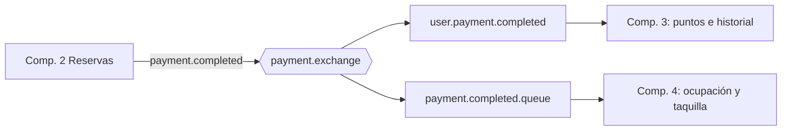

# Eventos publicados por el Componente 2

El Componente 2 es el **productor** de los eventos de pago. Este documento es el
contrato que deben respetar sus consumidores, los Componentes 3 y 4.

## Topología

| Elemento | Valor por defecto | Variable de entorno |
|---|---|---|
| Exchange | `payment.exchange` (topic, durable, sin auto-delete) | `PAYMENT_EXCHANGE` |
| Routing key de pago | `payment.completed` | `PAYMENT_COMPLETED_ROUTING_KEY` |
| Routing key de devolución | `payment.refunded` | `PAYMENT_REFUNDED_ROUTING_KEY` |

Reservas **solo declara el exchange**, con los mismos argumentos que los
consumidores para evitar `PRECONDITION_FAILED`. Las colas las declara cada consumidor:

| Consumidor | Cola | Binding | Clase que recibe el mensaje |
|---|---|---|---|
| Componente 3 Usuarios | `user.payment.completed` | `payment.completed` | `componente3_usuarios.events.PaymentCompletedEvent` (record) |
| Componente 4 Analítica | `payment.completed.queue` | `payment.completed` | `es.cineasee.analitica.events.PaymentCompletedEvent` (Lombok) |



## Propiedades del mensaje AMQP

| Propiedad | Valor |
|---|---|
| `content_type` | `application/json` |
| `content_encoding` | `UTF-8` |
| `message_id` | igual a `eventId` (UUID) |
| `type` y cabecera `eventType` | `PaymentCompleted` o `PaymentRefunded` |
| cabecera `aggregateId` | id de la reserva |
| `delivery_mode` | 2 (persistente) |

No se envía la cabecera `__TypeId__`. Cada consumidor deduce el tipo a partir del
parámetro de su `@RabbitListener`, y así no se comparten nombres de clases Java
entre microservicios.

## `PaymentCompleted` (routing key `payment.completed`)

Se publica cuando un pago se confirma. Los dos consumidores usan **nombres de
campo distintos** para algunos datos, así que el mensaje lleva ambos. Cada uno
ignora los campos que no conoce.

```json
{
  "eventId": "3f2c7a1e-9b1d-4c7a-8f2e-1a2b3c4d5e6f",
  "reservationId": 8901,
  "userId": 5590,
  "movieId": "550e8400-e29b-41d4-a716-446655440001",
  "amount": 15.30,
  "currency": "EUR",
  "purchaseDate": "2026-10-08T12:03:00Z",
  "occurredAt": "2026-10-08T12:03:00Z",
  "showId": "01ARZ3NDEKTSV4RRFFQ69G5FAV",
  "sessionId": "01ARZ3NDEKTSV4RRFFQ69G5FAV",
  "roomId": "550e8400-e29b-41d4-a716-446655440002",
  "ticketsCount": 2,
  "totalAmount": 15.30,
  "showStartTime": "2026-10-16T18:30:00Z",
  "timestamp": "2026-10-16T20:30:00"
}
```

| Campo | Comp. 3 | Comp. 4 | Descripción |
|---|:---:|:---:|---|
| `eventId` | ✔ | | UUID del evento |
| `reservationId` | ✔ | ✔ | Clave de idempotencia |
| `userId` | ✔ | ✔ | `null` en compras de invitado (el Comp. 3 no asigna puntos) |
| `movieId` | ✔ | ✔ | Película |
| `amount` | ✔ | | Importe cobrado, con descuentos |
| `totalAmount` | | ✔ | El mismo importe, con el nombre que usa el Comp. 4 |
| `currency` | ✔ | | Moneda |
| `purchaseDate` | ✔ | | Instante del pago (UTC) |
| `occurredAt` | ✔ | | Instante en que se generó el evento |
| `showId` | | | Sesión (nombre usado en la API de Reservas) |
| `sessionId` | | ✔ | La misma sesión, con el nombre que usa el Comp. 4 |
| `roomId` | | ✔ | Sala |
| `ticketsCount` | | ✔ | Número de entradas |
| `showStartTime` | | | Inicio de la sesión en UTC |
| `timestamp` | | ✔ | Inicio de la sesión en **hora local del cine** (Europe/Madrid, sin zona). El Comp. 4 lo usa para el día de la semana y la franja horaria |

Campos que el Comp. 4 tiene pero Reservas no envía, porque no son datos suyos:
`cinemaId` (Analítica usa `"1"` por defecto), y `movieTitle` y `genre`, que
Analítica obtiene de Cartelera a partir de `movieId`. Los campos `distributor` y
`distributorId` quedan a `null`: el catálogo ya no guarda la distribuidora
(`Movie.distributor` se eliminó).

`PaymentCompletedContractTest` comprueba que el mensaje se deserializa bien en
copias de las dos clases consumidoras, usando el mismo `JacksonJsonMessageConverter`.
**Si un compañero cambia su clase de evento, hay que actualizar ese test.**

## `PaymentRefunded` (routing key `payment.refunded`)

Se publica cuando una reserva pagada se anula y se devuelve (`DELETE /reservations/{id}`).

```json
{
  "eventId": "…",
  "reservationId": 8901,
  "userId": 5590,
  "movieId": "550e8400-e29b-41d4-a716-446655440001",
  "showId": "01ARZ3NDEKTSV4RRFFQ69G5FAV",
  "amount": 15.30,
  "currency": "EUR",
  "ticketsCount": 2,
  "refundedAt": "2026-10-09T10:00:00Z",
  "occurredAt": "2026-10-09T10:00:00Z"
}
```

Todavía no lo consume nadie: las dos colas actuales solo enlazan `payment.completed`.
Queda disponible para que Analítica descuente la recaudación y Usuarios retire los
puntos sin tocar Reservas.

## Garantías de entrega

- **Atomicidad con la BD (Transactional Outbox):** el evento se guarda en la tabla
  `outbox_events` en la misma transacción que confirma la reserva.
- **Publisher confirms:** el evento solo se marca como publicado cuando RabbitMQ
  confirma que lo ha recibido.
- **Reintentos:** si el broker está caído, el `OutboxRelay` lo reintenta cada 2 s.
- **Al menos una vez:** un evento puede llegar dos veces. El Comp. 3 descarta los
  duplicados por `reservationId`. El Comp. 4 hoy guarda cada mensaje que recibe,
  así que un duplicado contaría dos veces; para evitarlo, Analítica debería
  comprobar `reservationId` antes de guardar.
